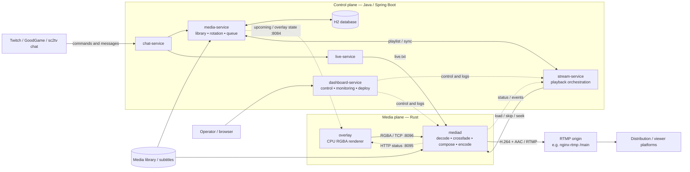

# media-server

**A self-hosted, continuously running media stream with chat controls, an animated overlay, and a web operations dashboard.**

`media-server` takes a local video library, schedules and plays tracks, mixes transitions and on-screen information, and publishes a continuous H.264/AAC RTMP stream. Viewers can request tracks and interact through Twitch, GoodGame, and sc2tv chat. Operators can search and manage the queue, inspect the stream, monitor processes, and deploy or roll back versions from a browser.

> **Branch:** This README describes [`experimental`](https://github.com/ftpud/media-server/tree/experimental), not the original per-track FFmpeg architecture. It is a personal project with deployment-specific defaults, **not** a turnkey multi-user or Internet-hardened distribution.

## Highlights

- **One continuous output:** `mediad` is a long-running Rust/libav* player, compositor, H.264 encoder, AAC encoder, and RTMP publisher. Track changes do not require reconnecting the stream.
- **Smooth transitions:** decoder threads, next-track pre-roll, video crossfades, optional audio crossfades, and black/silence filler when the playlist is empty.
- **Intel QSV, with fallback:** hardware H.264 encoding and supported hardware decoding on Intel GPUs; unsupported input codecs fall back to software decoding. The complete media stack can also run with `libx264` for development.
- **Animated overlay:** a separate, CPU-rendered Rust process creates now-playing cards, next-track banners, and chat-triggered list/search panels; frames are sent to `mediad` as RGBA over localhost TCP.
- **Library and chat:** Spring Boot services own library indexing, an H2 database, rotation, requests, search, tagging, messages, and scheduling.
- **Operations UI:** a single-page dashboard on port `9090` provides health metrics, logs, preview snapshots, transport controls, and versioned deployments with rollback.

## Architecture



**Control plane versus media plane:** `media-service` determines what should play, while `stream-service` sends commands and reconciles track events. `mediad` owns the output clock and media encoding. This keeps stream output alive across track changes and allows decoder failures to fall back to filler rather than stopping the publisher.

For a deeper breakdown of the decoder, compositor, and output threads, see [`mediad/`](mediad/) and the implementation notes in [`TODO.md`](TODO.md).

## Repository components

| Component | Stack | Responsibility |
| --- | --- | --- |
| [`mediad/`](mediad/) | Rust, FFmpeg 7.1 shared libraries | Persistent player, decoder selection, crossfades, overlay compositing, H.264/AAC encoding, RTMP reconnect, local HTTP API. |
| [`overlay/`](overlay/) | Rust | Renders animated cards and panels on the CPU; sends raw RGBA frames to `mediad`. |
| [`media-service/`](media-service/) | Java 11, Spring Boot, H2 | Media import/indexing, rotation, queue, search, metadata, and playback-position synchronization. |
| [`stream-service/`](stream-service/) | Java 11, Spring Boot | Schedules/loads the next track, handles `mediad` events and user transport commands. |
| [`chat-service/`](chat-service/) | Java 11, Spring Boot | Integrations for Twitch, GoodGame, and sc2tv; translates chat commands. |
| [`live-service/`](live-service/) | Java 11, Spring Boot | On-screen messages, written to a file consumed by `mediad`. |
| [`dashboard-service/`](dashboard-service/) | Java 11, vanilla JS | Playback controls, health, live logs, host metrics, preview, deployment and rollback. |
| [`media-shared/`](media-shared/) | Java | Common Java classes used by service modules. |
| [`publisher-service/`](publisher-service/), [`balance-service/`](balance-service/) | Java | **Legacy** FFmpeg/FIFO pipeline; retained for rollback, not run concurrently with `mediad`. |
| [`deploy/`](deploy/) | Shell | Existing-host cutover/rollback scripts. **They assume a particular host and layout.** |

## Requirements at a glance

| Area | Requirement |
| --- | --- |
| Host | Linux x86-64 (deployment scripts and GPU setup are Linux-specific); a readable local media filesystem. |
| Java | **JDK 11** and **Maven 3.x** (Spring Boot 2.7.17). |
| Rust | A recent stable Rust toolchain with Cargo; C toolchain, Clang/libclang and `pkg-config` for FFmpeg bindings. |
| FFmpeg | **FFmpeg 7.1.x shared libraries** (the verified host uses **7.1.5**). Build with the features used by `mediad`, not just the CLI binary. |
| GPU | **Optional for development.** For QSV: supported Intel GPU, enabled kernel/VA-API media driver, appropriate Media SDK/oneVPL runtime, and permission to `/dev/dri/renderD*`. |
| RTMP | An accepting RTMP endpoint (e.g. nginx with its RTMP module), or use a local file for testing. |
| UI/fonts | A font file with the desired Unicode coverage; the default renderer path is a machine-specific WenQuanYi `.ttc`. |

Full prerequisites, an FFmpeg **7.1.5 + QSV** build recipe, build commands, configuration, and end-to-end startup instructions are in **[GETTING_STARTED.md](GETTING_STARTED.md)**.

## Build summary

```bash
git clone --branch experimental https://github.com/ftpud/media-server.git
cd media-server

# First install/build FFmpeg 7.1.x shared libraries (see GETTING_STARTED.md).
# mediad/build-env.sh currently pins /home/ftpud/ffmpeg-7.1;
# edit it for your environment, or export FFMPEG_DIR/PKG_CONFIG_PATH/LD_LIBRARY_PATH directly.
cd mediad
source ./build-env.sh
cargo build --release
cd ../overlay
cargo build --release
cd ..

mvn -DskipTests -pl media-service,stream-service,chat-service,live-service,dashboard-service -am package
```

The Rust programs are built **outside** the Maven reactor. Java jars are produced under each module's `target/`, and Rust binaries under each crate's `target/release/`.

## Running

The shortest safe first run is a **standalone `mediad` → local file** test using `--encoder x264`, without starting any Java services or touching an existing stream. Then validate QSV if hardware is present. Finally start `mediad` against a **test RTMP application**, followed by the Java services, overlay, and dashboard.

```bash
# From mediad/, with FFmpeg library variables exported:
MEDIAD_W=1280 MEDIAD_H=720 ./target/release/mediad \
  --out /tmp/mediad-test.ts --encoder x264 --hwdec off \
  --port 18995 --play /path/to/sample.mp4
# Stop after the sample: mediad deliberately continues emitting filler forever.
```

See the [getting-started walkthrough](GETTING_STARTED.md#5-first-run-standalone-smoke-test) for creating test media, validating the output, setting up nginx-rtmp, and starting the full service stack.

## Local interfaces and defaults

| Endpoint | Service | Purpose |
| --- | --- | --- |
| `127.0.0.1:8095` | `mediad` | `/health`, `/status`, `/events`, `/load`, `/skip`, `/seek`, `/clear`, `/snapshot.jpg` |
| `127.0.0.1:8096` | `mediad` overlay input | Raw RGBA TCP from `overlay`, if enabled by `MEDIAD_OVERLAY`. |
| `:8084` | `media-service` | Library/rotation endpoints and overlay state. |
| `:8088` | `stream-service` | Streaming control / playback orchestration. |
| `:8089` | `live-service` | Live messages. |
| `:8090` | `chat-service` | Chat integration. |
| `:9090` | `dashboard-service` | Authenticated operator UI. |
| `:1935` (conventional) | RTMP origin | RTMP ingest, e.g. `rtmp://127.0.0.1/main`; actual port depends on nginx configuration. |

> The `mediad` API is bound to loopback but its mutating endpoints use HTTP **GET** and do **not** provide their own authentication. Keep it private. Avoid publicly exposing the Java services or dashboard without appropriate access controls and TLS.

## Testing

```bash
cd mediad && source ./build-env.sh && cargo test
cd ../overlay && cargo test
cd ..
mvn -pl media-service,stream-service -am test

# After building the release mediad binary and FFmpeg with libx264:
bash mediad/tests/sync_test.sh
```

The A/V sync test generates synthetic audio/video, runs multiple transitions, and checks that measured offset stays consistent; its sample implementation documents an expected constant AAC encoder delay rather than perfect zero-offset samples.

## Deployment / rollback

The dashboard supports staged versions of Java jars and Rust executables, maintains archived versions, and can restore previous deployments. The existing deployment workflow uses a host-specific runtime directory, historically `/home/ftpud/media-server/app`, with `ext/` for `mediad` and `overlay`, `logs/`, `versions/`, `config.properties`, and `mediad.conf`. **Adapt hard-coded paths before deploying anywhere else.**

The repository's [`deploy/cutover.sh`](deploy/cutover.sh) and [`deploy/rollback.sh`](deploy/rollback.sh) are **migration/rollback scripts for that existing installation**, not generic installation scripts. In particular, do not start the legacy `publisher-service` while `mediad` is publishing to the same RTMP application.

## Current limitations

- This is optimized for a specific personal library and server. Default absolute paths, a rotation convention (`___UNDERGROUND`), and some deployment assumptions require customization.
- FFmpeg must be dynamically linked consistently: do not accidentally compile against one FFmpeg version and load another at runtime.
- Hardware decode is codec/profile/GPU-generation dependent. Unsupported content is decoded in software; QSV **encoding** still requires a working Intel media runtime.
- The current dashboard uses a single operator token; `mediad` itself offers only a local, unauthenticated control API.
- Persistent uptime, disk health, permissions on uploaded files, and access to the GPU render node are operational concerns, not automatically handled by Cargo/Maven.
- The legacy code remains in the repository for recovery. The two publishers should not run simultaneously to one ingest endpoint.

## Related documentation

- **[Getting started](GETTING_STARTED.md)** — build FFmpeg with QSV, compile, configure, test, run, troubleshoot.
- [`TODO.md`](TODO.md) — implementation history, host-specific findings, feature status and follow-up work; treat older phase notes as historical.
- [FFmpeg documentation](https://ffmpeg.org/documentation.html) and [Intel's FFmpeg QSV plugin notes](https://github.com/intel/media-delivery/blob/master/doc/features/ffmpeg-qsv/README.md).
